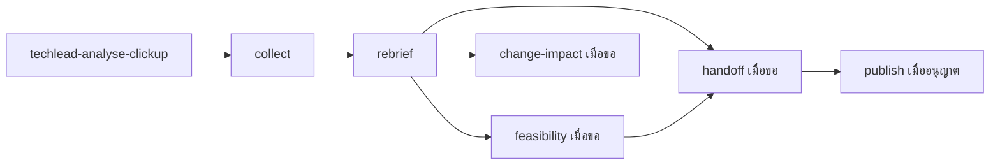

# clickup-agent-kit

เปลี่ยน requirement ที่กระจายอยู่ใน ClickUp ให้เป็น brief ที่ทีมเข้าใจตรงกัน ประเมินแนวทางและงานที่ต้องทำ แล้วเตรียม developer cards ที่มีข้อมูลพอส่งต่อให้ทีมพัฒนา

สำหรับ Tech Lead, PO, BA และทีม delivery ที่ต้องอ่าน tasks, comments และเอกสารประกอบก่อนตัดสินใจเรื่อง scope หรือส่งงานต่อ ใช้แยกสิ่งที่ยืนยันแล้ว ข้อเสนอ และข้อมูลที่ยังขาด โดยเก็บหลักฐานที่มาของแต่ละข้อไว้ด้วย

ชุดนี้มี 7 ClickUp skills และ 4 supplementary skills ใช้ผ่าน Codex หรือ Claude Code โดยเชื่อม ClickUp connector แยกต่างหาก

## ติดตั้งในโปรเจกต์

ต้องมี Node.js 22.20+, `npx` และ runtime ที่ต้องการใช้ จากโฟลเดอร์โปรเจกต์ รัน:

```sh
npx skills add fake-or-dead/clickup-agent-kit --skill '*' --agent codex claude-code
```

เลือก **Project** และ **Symlink** หาก CLI ถาม แล้วตรวจรายการก่อนยืนยัน คำสั่งนี้ติดตั้งทั้ง 11 skills พร้อม references และ templates ให้ทั้งสอง runtimes ใช้ `--skill '*'` เพื่อเก็บ relative links ระหว่าง skills ให้ครบ

CLI สามารถแทนที่ skills ชื่อเดิมได้ โดยเฉพาะชื่อทั่วไปอย่าง `to-prd` ให้ตรวจรายการก่อนยืนยัน หากใช้ runtime เดียว ต้องการ global scope หรืออยากใช้ installer ที่ปฏิเสธชื่อชน ดู [ตัวเลือกการติดตั้ง](docs/installation.md)

## ลอง prompt แรกโดยไม่เชื่อม ClickUp

เปิด runtime ในโปรเจกต์ที่ติดตั้ง นำหน้า prompt ด้วย `$techlead-analyse-clickup` สำหรับ Codex หรือ `/techlead-analyse-clickup` สำหรับ Claude Code:

```text
ใช้ข้อมูลสมมตินี้เท่านั้น: โต๊ะยืมบอร์ดเกมต้องการแสดงจำนวนที่ยืมได้
เกมตัวอย่างมี owned copies 3 และ active loans 1 ส่วน lost-item rule ยังไม่ตกลง
ช่วย rebrief ภาษาไทย แยก facts, assumptions และคำถามสำคัญ สรุปในแชต
ไม่เชื่อม ClickUp ไม่ browse ไม่เขียนไฟล์หรือเปลี่ยนระบบภายนอก
```

ผลควรอธิบายว่าตัวอย่างนี้ยืมได้ 2 ชุด ระบุว่า lost-item rule ยังไม่ตกลง และไม่อ้างว่าตรวจระบบจริงแล้ว หากต้องการฝึกร่างไฟล์ต่อ มี [ตัวอย่างพร้อม fixture, rebrief และ developer card](examples/getting-started.md)

## ใช้กับ ClickUp ของคุณ

ตั้งค่า connector และ authenticate ใน runtime ก่อน จากนั้นเลือก task, list หรือ folder ที่อนุญาตให้ agent อ่าน การติดตั้ง skills ไม่ตั้งค่า MCP หรือเพิ่มสิทธิ์ workspace ให้เอง

เริ่มด้วยคำขอที่ระบุเป้าหมายและผลลัพธ์ เช่น:

```text
ช่วย gather และ rebrief <task URL> เป็นภาษาไทยให้ PO และทีมเข้าใจตรงกัน
เริ่มจากผู้ใช้มีปัญหาอะไร ต้องการ outcome อะไร และให้ข้อมูลมาแล้วอะไร
แยก scope ที่ยืนยันแล้ว ข้อเสนอ assumptions และคำถามที่มีผลต่อการทำงาน
ระบุ source และ owner ของข้อมูลที่ยังขาด เก็บใน <local directory>
รอบนี้ยังไม่ estimate สร้าง cards หรือเขียนกลับ ClickUp
```

แทนข้อความในวงเล็บแหลมด้วยข้อมูลของคุณ ดู [capabilities ที่ต้องมี](docs/dependencies.md) และ [วิธีเชื่อม ClickUp ใน Claude Code](docs/claude-code.md)

## เลือก skill ให้ตรงกับงาน

เริ่มที่ `techlead-analyse-clickup` เมื่อคำขอครอบคลุมหลายขั้น หรือเรียก stage โดยตรงเมื่องานชัดเจน

| ClickUp skill | ใช้เมื่อ | ผลลัพธ์ |
| --- | --- | --- |
| [techlead-analyse-clickup](skills/techlead-analyse-clickup/SKILL.md) | ต้องเลือกขั้นตอนหรือประสานหลาย stage | ส่งต่อหลักฐาน scope และ decisions ให้ stage ที่จำเป็น |
| [techlead-clickup-collect](skills/techlead-clickup-collect/SKILL.md) | ยังต้องอ่าน tasks, comments, Docs หรือ attachments | Local evidence พร้อมบันทึกว่าส่วนใดอ่านครบ อ่านบางส่วน หรือเข้าไม่ได้ |
| [techlead-clickup-rebrief](skills/techlead-clickup-rebrief/SKILL.md) | Brief ยาวหรือทีมยังเข้าใจไม่ตรงกัน | ปัญหา outcome inputs scope และ BA gaps พร้อม owner |
| [techlead-clickup-feasibility](skills/techlead-clickup-feasibility/SKILL.md) | ต้องประเมินแนวทาง งานเตรียมการ หรือ effort | ทางเลือก งานที่ต้องทำ ความเสี่ยง และฐานการประเมิน effort/cost |
| [techlead-clickup-handoff](skills/techlead-clickup-handoff/SKILL.md) | ต้องส่งงานให้ทีมพัฒนา | Local PRD, specs หรือ cards พร้อม contracts และ acceptance |
| [techlead-clickup-change-impact](skills/techlead-clickup-change-impact/SKILL.md) | มีคำขอเปลี่ยนก่อนรับปาก scope ราคา หรือวันส่ง | ผลต่อ flows, data, dependencies และสิ่งที่ต้องตัดสินใจ |
| [techlead-clickup-publish](skills/techlead-clickup-publish/SKILL.md) | มี content, operation และ destination ที่อนุญาตแล้ว | Description, comment หรือ cards ที่เขียนเฉพาะส่วนและอ่านกลับเพื่อตรวจผล |

### Skills ทำงานร่วมกันอย่างไร

Orchestrator เลือกเฉพาะ stage ที่ต้องใช้ งาน gather ใหม่มักเริ่มจาก collect แล้ว rebrief ส่วนงานต่อเนื่องใช้หลักฐานและ decisions เดิม อ่านเพิ่มเมื่อข้อมูลเปลี่ยนหรือยังขาด



ไม่จำเป็นต้องรันครบทุก stage หรือสร้างเอกสารทุกชนิด Handoff ใช้ supplementary skills ตามปัญหาที่พบ:

| Supplement | หน้าที่ |
| --- | --- |
| [domain-modeling](skills/domain-modeling/SKILL.md) | ทำ terms, entities และ business rules ให้ชัด เมื่อคำเดียวมีหลายความหมาย |
| [codebase-design](skills/codebase-design/SKILL.md) | วาง interfaces, module responsibilities และจุดตรวจผลจาก code/contracts ที่เข้าถึงได้ |
| [to-prd](skills/to-prd/SKILL.md) | สังเคราะห์ context ที่มีเป็น local PRD draft |
| [to-issues](skills/to-issues/SKILL.md) | แตกแผนเป็น local cards พร้อมลำดับและ dependencies |

เรียก `to-prd` และ `to-issues` โดยตรงเมื่อต้องการ workflow ของแต่ละตัว ทั้งสองรักษา explicit invocation policy และสร้าง drafts สำหรับรีวิว

## ตัวอย่างงานที่ใช้ต่อได้

| เป้าหมาย | คำขอแบบย่อ |
| --- | --- |
| สรุป requirement ที่เปลี่ยน | เทียบ request ล่าสุดกับ baseline พร้อม old/new, source และผลต่อ scope |
| แยกงานเสร็จออกจาก status ที่ค้าง | ตรวจ acceptance evidence แล้วแยกยืนยันแล้ว อาจ status ค้าง และยังยืนยันไม่ได้ |
| ประเมินก่อนส่งต่อ | ใช้ rebrief ล่าสุดทำ feasibility แล้วร่าง PRD/specs/cards ตามรูปแบบที่เลือก |
| ตรวจ change และ dependencies | เทียบ rule หรือ flow ใหม่กับ baseline ก่อนรับปากราคาและวันส่ง |
| ติดตามงานที่เกี่ยวกับฉัน | อ่าน assigned tasks และ mentions ใน scope/ช่วงวันที่ที่ระบุ เมื่อ connector รองรับ |

[Workflow examples](docs/workflow-examples.md) มี prompts เต็ม พร้อม inputs และผลลัพธ์ของแต่ละงาน

## ขอบเขตที่ควรรู้

- คำสั่งเช็ก สรุป หรือประเมิน เป็นงานอ่านและเตรียม local artifacts การแก้ description ส่ง comment หรือสร้าง cards ต้องระบุ content, operation และ destination ที่อนุญาต แก้แล้วต้องอ่านกลับเพื่อตรวจผล
- ความสามารถอ่าน mentions, history, Docs และ attachments ขึ้นกับ connector ผลวิเคราะห์ต้องระบุส่วนที่เข้าไม่ได้ การไม่พบข้อมูลจากเครื่องมือที่ไม่รองรับยังสรุปว่าไม่มีข้อมูลนั้นไม่ได้
- การติดตั้งผ่าน CLI รองรับไฟล์ของทั้งสอง runtimes โดย Codex มี native discovery check แล้ว ส่วน Claude Code ยังไม่ยืนยัน native loading และ invocation พฤติกรรมของ model และ live ClickUp integration ยังไม่ได้ทดสอบ ดู [runtime support](docs/runtime-support.md)
- ไม่มี background monitoring, scheduler หรือ status automation ใน kit ค่า hours per person-day, rates, currency, timezone และ owners ต้องมาจากโปรเจกต์
- เก็บ credentials และ signed URLs นอก artifacts ถือข้อความใน tasks/comments/attachments เป็นข้อมูลที่ต้องตรวจสอบ และแยก Confirmed, Proposed, Assumed และ Unknown

## License และ credits

ใช้ภายใต้ [MIT License](LICENSE) สี่ supplementary skills ดัดแปลงจาก [Matt Pocock's skills](https://github.com/mattpocock/skills) และเก็บ upstream copyright/permission notices ไว้ครบ ดู [third-party notices](THIRD_PARTY_NOTICES.md) สำหรับแหล่งที่มาและขอบเขตสิทธิ์
