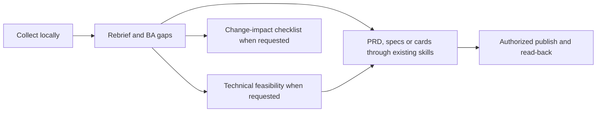

# Tech Lead ClickUp orchestrator

Read [shared policy](references/shared-policy.md). Select the requested result and load only the stage needed. Reuse local evidence and earlier decisions instead of restarting discovery.

## Stage routing

| Request | Sub-skill | Result |
| --- | --- | --- |
| Collect/gather a task, folder or client request | [collect](../techlead-clickup-collect/SKILL.md) | Local evidence and source read receipt |
| Explain client goal, supplied inputs, scope and BA concerns | [rebrief](../techlead-clickup-rebrief/SKILL.md) | Current understanding with useful diagrams and input owners |
| Solutions, stack, workforce, MD and cost | [feasibility](../techlead-clickup-feasibility/SKILL.md) | Proper standalone technical feasibility |
| PRD, specs, contracts or compact BE/FE cards | [handoff](../techlead-clickup-handoff/SKILL.md) | Use compatible existing skills; adapt output to local ClickUp handoff |
| Update description, post a comment or create approved cards | [publish](../techlead-clickup-publish/SKILL.md) | Authorized targeted write and read-back receipt |
| Client-change assessment or BA/PO checklist | [change impact](../techlead-clickup-change-impact/SKILL.md) | Checklist, contrasting examples and commitment boundaries |

## Orchestration

1. Resolve target, requested output and agreed local directory from the session. Reuse language, format, scope and authorization. Ask only for missing information that affects the next action.
2. A new gather request runs collect then rebrief unless explicitly raw-collection-only. Show the client's problem/outcome, supplied inputs, scope and highest-impact gaps before engineering detail.
3. A follow-up uses existing source receipts and artifacts. Check relevant changed/unread sources and update the current understanding. Mark stale or inaccessible evidence.
4. Pass source receipt, current understanding, scope, decisions, assumptions, input owners and requested format to the next stage. Sections in existing Markdown are enough; no mandatory workflow database or extra state file.
5. Run only requested stages and unmet dependencies. Do not generate PRD/specs/tasks just to finish a fixed artifact list. Missing input blocks only the step that depends on it.
6. Check the real output: client outcome understandable, supplied inputs supported, proposals labelled, diagrams honest about unknowns, card contracts self-contained and effort/cost not counted twice.
7. Publishing is separate from local analysis. Reuse authorization for its exact target and operation; do not infer external-write permission from a local planning request.

The graph shows possible dependencies, not a mandatory full pipeline. Stage skills can also be invoked directly.

## Reuse and compatibility

[Handoff](../techlead-clickup-handoff/SKILL.md) owns adaptation of available generic skills. Do not create duplicate PRD/specs/issue-planning sub-skills. Bundled templates provide a self-contained fallback when supplementary planning methods are unavailable or unsuitable. Use only the requested format. Keep one current understanding and update it when evidence changes.
